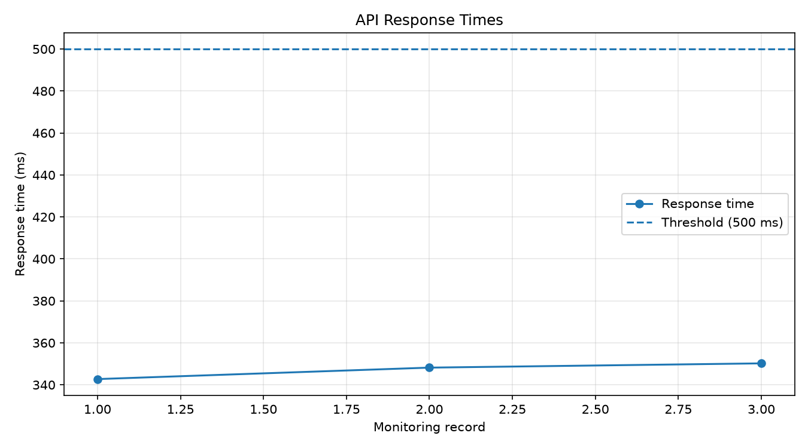
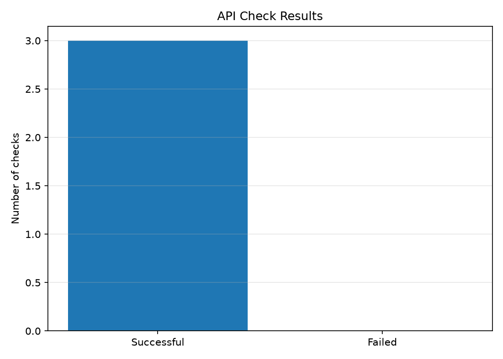
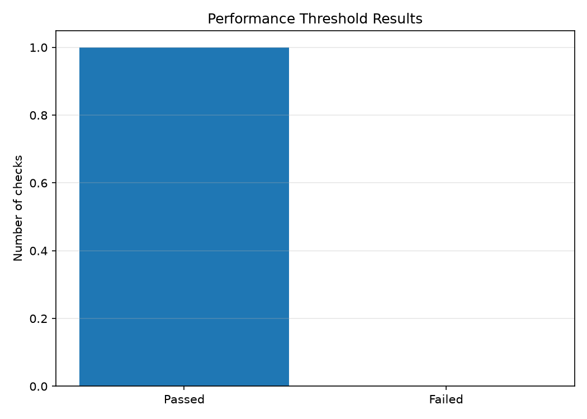

# GitHub API Quality Monitor

[](https://github.com/sritejaswiniraj-commits/github-api-quality-monitor/actions)

A Python-based API monitoring and quality analysis project that evaluates the availability, response time, response structure, and rate-limit information of the GitHub REST API.

The project combines API monitoring, automated testing, performance checks, historical trend analysis, visual reporting, and continuous integration using GitHub Actions.

## Features

- **API availability monitoring:** Checks HTTP responses and identifies unsuccessful requests.
- **Response-time measurement:** Records API request duration in milliseconds.
- **Response validation:** Verifies required JSON fields and expected data types.
- **Rate-limit tracking:** Records the remaining GitHub API request allowance.
- **Error handling:** Handles HTTP errors, invalid JSON, timeouts, request failures, and unexpected response structures.
- **Historical logging:** Stores timestamped monitoring results in JSON Lines (`JSONL`) format.
- **Historical analysis:** Calculates success rates, failed checks, and response-time statistics.
- **Trend analysis:** Compares earlier and later portions of the monitoring history to identify changes in reliability and response times.
- **Performance monitoring:** Evaluates response times against a 500 ms threshold and tracks performance pass rates separately from API availability.
- **Visual reporting:** Generates PNG charts for response times, API check results, and performance threshold results.
- **Automated testing:** Uses pytest and mocked HTTP responses to validate monitoring and reporting behavior.
- **Continuous integration:** Runs the automated test suite through GitHub Actions.
- **Interactive dashboard:** Uses Streamlit and Plotly to display monitoring KPIs, filter historical results by date and record count, and explore response-time and performance charts.

## Technology Stack

- Python 3.12
- Requests
- Matplotlib
- pytest
- GitHub REST API
- GitHub Actions
- JSON / JSONL
- Streamlit
- Plotly

## Project Structure

```text
```text
github-api-quality-monitor/
├── .github/
│   └── workflows/
│       ├── tests.yml
│       └── scheduled-monitor.yml
├── results/
│   └── history.jsonl
├── reports/
│   ├── response_times.png
│   ├── api_success_failures.png
│   └── performance_pass_rate.png
├── tests/
│   ├── test_monitor.py
│   ├── test_analyze_history.py
│   ├── test_generate_reports.py
│   └── test_dashboard_utils.py
├── app.py
├── dashboard_utils.py
├── monitor.py
├── analyze_history.py
├── generate_reports.py
├── requirements.txt
├── .gitignore
└── README.md
```
```

The `results/history.jsonl` file stores monitoring results and may not exist in a fresh checkout until the monitor has been run. The report generator uses the saved history to create charts in the `reports/` directory.

## Setup

### 1. Clone the repository

```bash
git clone https://github.com/sritejaswiniraj-commits/github-api-quality-monitor.git
cd github-api-quality-monitor
```

### 2. Create and activate a virtual environment

```bash
python3 -m venv .venv
source .venv/bin/activate
```

### 3. Install dependencies

```bash
python -m pip install -r requirements.txt
```

## Usage

### Launch the interactive dashboard

```bash
python -m streamlit run app.py


### Run an API check

```bash
python monitor.py
```

This checks the configured GitHub API endpoint and records the result in the history file.

### Analyze historical results

```bash
python analyze_history.py
```

The analysis reports successful and failed checks, success rate, response-time statistics, performance pass rate, and available trend comparisons.

### Generate visual reports

```bash
python generate_reports.py
```

The generated charts are saved in the `reports/` directory.

## Visual Reports

### 1. API Response Times

Displays response times by monitoring run, shows the 500 ms performance threshold, and annotates measurements that exceed the threshold.



### 2. API Check Results

Compares successful and failed API checks, displays the count for each category, and includes the overall API success rate.



### 3. Performance Threshold Results

Compares passed and failed performance checks, displays the count for each category, and includes the overall performance pass rate. Only records containing valid Boolean performance results are included.



## Automated Testing

Run the full test suite with:

```bash
python -m pytest -v
```

The tests cover:

- Successful API responses and HTTP errors
- Missing required fields and invalid response structures
- Invalid JSON and request timeouts
- Response-time performance thresholds
- Historical success-rate and response-time calculations
- Performance pass-rate calculations
- Backward compatibility with older history records
- Trend calculations and insufficient historical data
- Chart generation, missing history, and malformed JSON records

The monitoring tests use mocked HTTP responses to exercise different scenarios without requiring a live API response for every test.

**Latest verified local result:** 44 tests passed.

## Continuous Integration

GitHub Actions runs the pytest suite when code is pushed or a pull request is opened.

[View GitHub Actions workflow runs](https://github.com/sritejaswiniraj-commits/github-api-quality-monitor/actions)

## Current Limitations

- Trend analysis compares earlier and later portions of the available history; it is not a forecast.
- Trend results can be unreliable when only a small number of monitoring records are available.
- Performance trends require sufficient records with performance results.
- The current charts are static PNG files generated from saved history rather than live dashboards.
- Historical results depend on the monitoring records available in the history file.
- The interactive dashboard currently runs locally; public deployment has not yet been configured.

## Potential Future Improvements

- Configurable API endpoints and performance thresholds
- Custom failure notifications
- More advanced historical trend analysis
- Exportable monitoring reports
- Additional API endpoints and configurable validation rules

## Author

**Tejaswini Raj Sri Raja**

[GitHub Repository](https://github.com/sritejaswiniraj-commits/github-api-quality-monitor)
